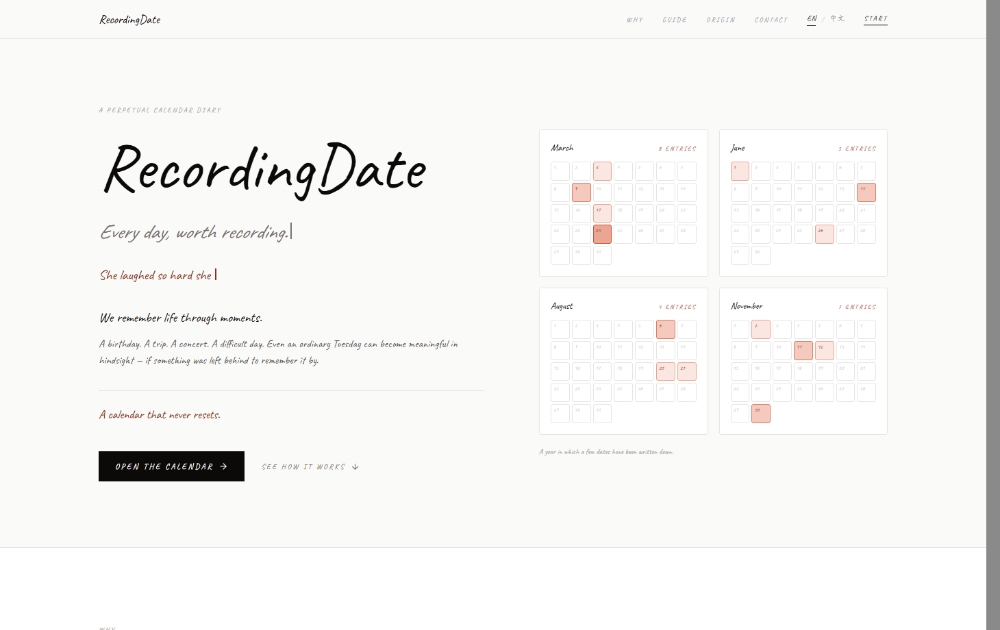
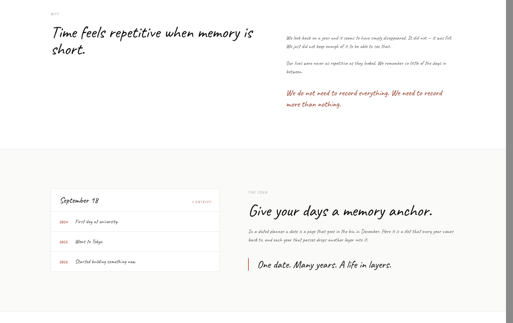
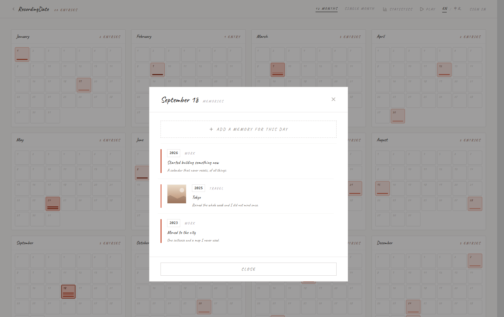
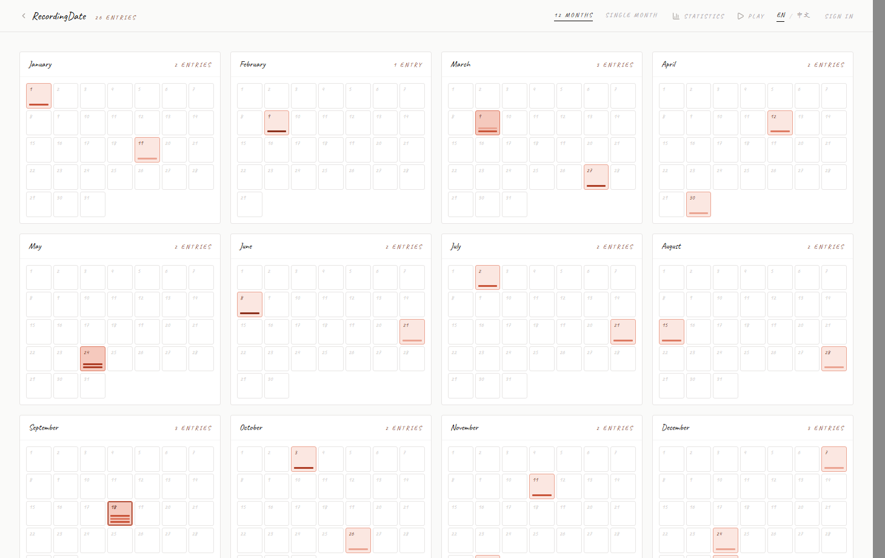
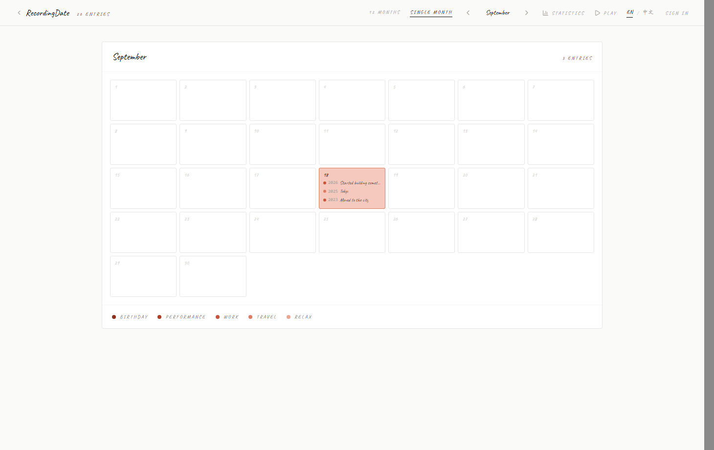
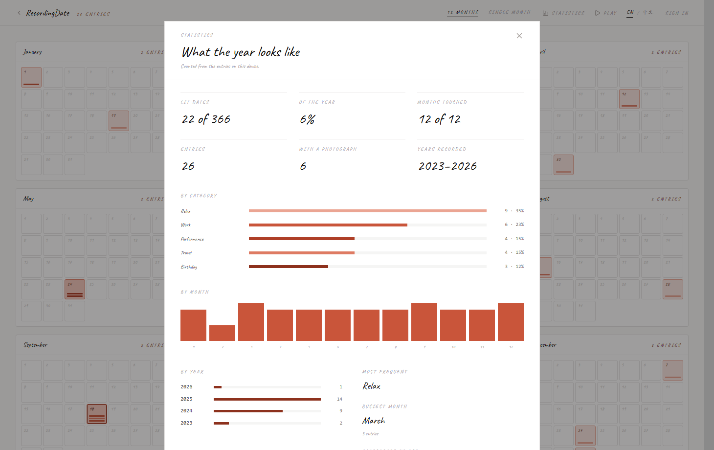
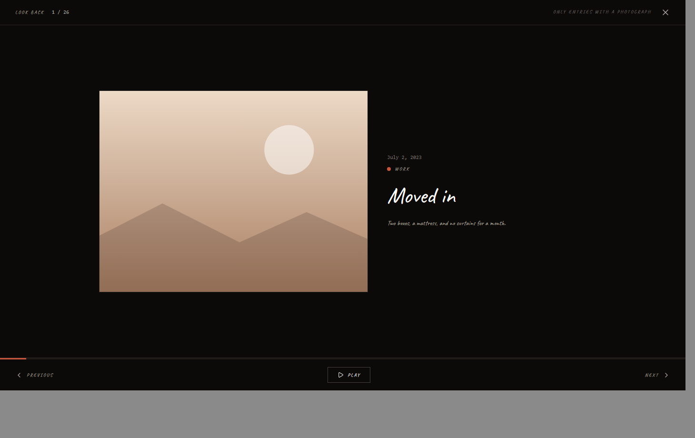

# RecordingDate

**A calendar that never resets.**

*Every day, worth recording.*

**[Open the web app →](https://recordingdate.netlify.app/)** &nbsp;·&nbsp; **[Download the Android app ↓](#android)**

---

## Get it

| Where | How |
|---|---|
| **Web** | [recordingdate.netlify.app](https://recordingdate.netlify.app/) — any modern browser, nothing to install. It also installs to a phone's home screen. |
| **Android** | [**RecordingDate-0.6.0.apk**](RecordingDate-0.6.0.apk) — a debug build you install by hand. |

### Installing the Android app

1. Download **`RecordingDate-0.6.0.apk`** on the phone (or copy it across from a computer).
2. Tap the file. Android will ask to allow installs from this source — allow it for whichever app you used (browser or file manager).
3. Tap **Install**, then open it.

> The APK is **debug-signed** with a throwaway key. That is fine for installing by hand, but Google Play Protect may show an "unknown app" notice — choose *Install anyway*. It is not distributed through Google Play.

Neither build asks for an account: the calendar works in full offline, keeping everything on the device until you choose to sign in.

## What it is

RecordingDate is a calendar you keep instead of throw away. The twelve months stay put,
every year comes back to the same cells, and whatever you write on a date is still there
the next time that date comes round.

It is not a planner. There is no week to fill in, no streak to protect, and nothing to
finish. A date is a slot, and each year that passes drops another layer into it.

| | |
|---|---|
| **366 dates** | February keeps its leap day. |
| **Twelve months** | Laid out at once, or one at a time. |
| **One colour** | Cinnabar, and it means exactly one thing: you wrote something here. |
| **One line** | A sentence is a complete record. So is a photograph. |
| **Nothing expires** | A date you skip this year is still sitting there next year. |
| **English / 中文** | Switchable at any time, remembered on the device. |

## Why a calendar, and why one that never resets

Time feels repetitive when memory is short. We look back on a year and it seems to have
simply disappeared — it did not. It was full. We just did not keep enough of it to be able
to see that.

A dated planner is a disposal: December arrives, every page goes in the bin, and with it
the answer to the only question worth asking. Diaries that lasted were never organised by
months and weeks. They were ordered by dates, so that the third of March in 2011 sits next
to the third of March in 2019, and ten years of a life line up in one column.

**One date. Many years. A life in layers.**

## A date fills up in seconds

Open any of the 366 squares, write a headline, and stop. The story, a photograph, or a category can all come later — years later, if that is when you remember.

The moment you save, that date takes the cinnabar tint. Blank days stay white paper. The
year slowly becomes a record of where the weight was.

## It stays legible as it fills up

Twelve months at once, for scanning the shape of a year:

Or a single month, large enough to read:

Each entry carries a category, and the five categories are told apart by the *depth* of the
same red rather than by hue — five different colours at three pixels wide would be noise.

## Looking back

Statistics counts what you have kept: how many dates are lit, how much of the year that is,
which months and years carry entries, and which category leads.

Play runs a full-screen slideshow of everything, oldest first — photographs framed, days
without one set as a page of text. Arrow keys move, space pauses.

## You do not need an account

The calendar works in full without one, and everything you write stays in that browser.
Nothing is uploaded and nothing is asked for.

If you do sign in later, what you wrote as a visitor is **merged into your account** rather
than discarded, on top of whatever the account already held. Nothing is lost by waiting. The
Android app works the same way, and keeps working with no network either way.

## Get in touch

I am open to suggestions, ideas, or just a hello.

**[Lyu](mailto:xinyaolv3@gmail.com)** — I read everything that arrives.

---
---

# RecordingDate 中文版

**一本永不重置的日历。**

*Every day, worth recording.*

**[打开网页版 →](https://recordingdate.netlify.app/)** &nbsp;·&nbsp; **[下载安卓版 ↓](#android-zh)**

---

## 获取

| 平台 | 方式 |
|---|---|
| **网页** | [recordingdate.netlify.app](https://recordingdate.netlify.app/) — 现代浏览器直接打开，无需安装。也可以添加到手机主屏。 |
| **安卓** | [**RecordingDate-0.6.0.apk**](RecordingDate-0.6.0.apk) — 手动安装的 debug 包。 |

### 安卓安装方法

1. 在手机上（或从电脑传过去）下载 **`RecordingDate-0.6.0.apk`**。
2. 点开这个文件。系统会询问是否允许来自该来源的安装——对你用的那个应用（浏览器或文件管理器）允许即可。
3. 点 **安装**，然后打开。

> 这个 APK 用的是 **debug 签名**（临时密钥）：自己安装完全没问题，但 Google Play 保护机制可能提示"未知应用"——选 *仍然安装* 即可。它没有上架 Google Play。

两个版本都不需要账号：日历完全离线可用，在你选择登录之前，一切都只留在设备上。

## 这是什么

RecordingDate 是一本用来留着、而不是用完就丢的日历。十二个月永远在那儿，每年回到同样的格子里，
而你写在某个日期上的东西，等这个日期下次转回来时还在原处。

它不是手账。没有一整周要填，没有连续打卡要守，也没有任何"完成"这回事。
一个日期就是一个位置，每过一年，就在里面多叠一层。

| | |
|---|---|
| **366 个日期** | 二月保留闰日。 |
| **十二个月** | 可以一次铺开，也可以一个月一个月看。 |
| **只有一种颜色** | 朱红，而且只表示一件事：这一天你写过东西。 |
| **一行也算数** | 一句话就是一条完整的记录，一张照片也是。 |
| **什么都不会过期** | 今年跳过的日期，明年还在原处等着你。 |
| **English / 中文** | 随时切换，在本机记住你的选择。 |

## 为什么是日历，又为什么永不重置

记忆一短，时间就显得重复。回头看一年，常觉得它就这么消失了——其实没有。它是满的，
只是我们留下的太少，少到看不出来。

带年份的手账本质上是一次性用品：十二月一到，每一页都进了回收站，连同那个唯一值得回答的问题一起扔掉。
真正留得下来的日记，从来不是按月、按周编排的，而是按日期。于是 2011 年的 3 月 3 日，
会和 2019 年的 3 月 3 日挨在一起，十年的生活排进同一列。

**一个日期，很多年。人生是一层层叠上去的。**

## 填一个日期只要几秒

打开 366 个格子里的任意一个，写一个标题，就可以停下。故事、照片、分类，
都可以以后再补——哪怕隔了好几年才想起来。

保存的那一刻，这个日期就染上朱红。空白的一直是白纸。一年就这样慢慢成了"重量落在哪里"的记录。

## 写得越多，越看得清

十二个月一次铺开，看一整年的形状：

或者只看一个月，大到能读清每一天：

每条记录都有分类，而这五个分类是靠**同一个红色的深浅**区分的，不是靠色相——
三像素宽的地方放五种颜色只会变成一团噪点。

## 回头翻一翻

统计会数清你留下了什么：点亮了多少天、占全年的多少、哪些月份和年份有记录、哪个分类最多。

回顾会用全屏灯箱从最早的一条开始播放，有照片的给照片，没照片的整页留给文字。
方向键翻页，空格暂停。

## 不需要账号

不注册也能完整使用，你写的一切都留在那个浏览器里。不上传任何东西，也不问你要任何东西。

之后如果注册登录，访客模式写下的内容会**并入你的账号**，而不是被丢掉，并且叠在账号原有的记录之上。
晚一点注册不会损失任何东西。安卓端同理，两端在没有网络时都照常可用。

## 联系我

欢迎建议、想法，或者只是来打个招呼。

**[Lyu](mailto:xinyaolv3@gmail.com)** — 每一封我都会看。
